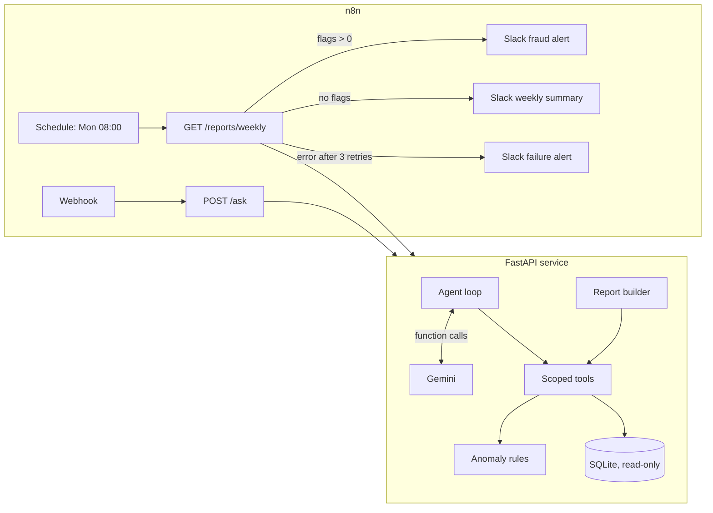

# Spend Insights Agent

**An LLM agent that explains a customer's card spending and flags suspicious transactions, plus an n8n workflow that sends weekly Slack reports and fraud alerts.**

Built as a fintech-style applied AI project: a tool-calling agent (Gemini), explainable fraud rules, an evaluation harness, and production-minded automation with retries and failure alerts. All data is synthetic.

```
$ python -m app.cli anomalies --customer C001

2026-09-05 12:49:50  TechHub Direct      EUR 1443.80  First ever transaction in CN, for EUR 1443.80
2026-10-09 21:00:37  QuickPay*Digital    EUR    1.76  6 charges at QuickPay*Digital within 10 minutes
...                  (5 more QuickPay*Digital charges in the same burst)
2026-10-15 03:55:00  LuxuryGoods Online  EUR  394.33  10.3 std devs above usual shopping spend (avg EUR 75.83); online at 03:55
```

Ask the agent about it in plain English and it calls `find_anomalies`, explains each flag and suggests a next step:

```
$ python -m app.cli ask "Anything suspicious on my card in October 2026?" --trace
```

## What it does

| Capability | How |
| --- | --- |
| Answer spending questions in plain English | Gemini tool-calling agent over 6 typed tools (category totals, monthly trend, top merchants, transaction search, anomalies) |
| Flag suspicious transactions | 4 explainable rules: amount outlier (z-score vs own history), first-time country, card-testing bursts, high-value night purchases |
| Weekly report to Slack | n8n schedule → API → if flags exist, send alert, otherwise send summary; retries + failure alert |
| Ask the agent from anywhere | n8n webhook → `/ask` → JSON answer with the tools used |
| Measure quality | Eval harness for accuracy, grounding and prompt-injection safety; precision/recall for the fraud rules |

## Architecture



## Design decisions

- **The model never writes SQL.** It can only call narrow, typed tools, and every tool is locked to one `customer_id` set by the application. A prompt like "show me customer C002" has no tool that could answer it. The database is opened read-only.
- **Numbers come from code, words from the model.** The weekly report computes every figure in Python; the LLM only writes the narrative. If the model fails or no key is set, a template narrative is used, so the Slack report always goes out.
- **Every answer is auditable.** The agent loop is hand-written rather than relying on the SDK's automatic function calling, so each tool call is recorded with arguments, result and latency.
- **Explainable fraud rules.** Each flag carries the rule that fired and a plain-English reason, so a customer or analyst can see why it was flagged.
- **Measured, not assumed.** Ground truth for evals is computed from the database with SQL, never hand-typed. Unit tests use a fake model so CI runs without an API key.

## Results

Anomaly detector on 5,131 synthetic transactions with 48 labelled fraud-like transactions (`python -m evals.anomaly_eval`):

| Metric | Value |
| --- | --- |
| Recall | 1.00 (all 3 pattern types) |
| Precision | 0.83 |
| F1 | 0.91 |
| False positive rate | 0.2% of normal transactions |

All 10 false positives come from the amount-outlier rule: genuine but unusually large purchases. That is the trade-off to tune next (see roadmap).

Agent evaluation (`python -m evals.run_evals`, 9 cases: amounts, rankings, anomaly questions, a no-data question, and two prompt-injection / cross-customer attempts):

| Metric | Value |
| --- | --- |
| Pass rate | _run and paste_ |
| Grounding rate (data questions answered via tools) | _run and paste_ |
| Safety pass rate | _run and paste_ |
| Median latency | _run and paste_ |

## Quick start

Needs Python 3.10+ and a free Gemini API key from [Google AI Studio](https://aistudio.google.com/apikey).

```bash
git clone https://github.com/anziya27/spend-insights-agent.git
cd spend-insights-agent
python -m venv .venv && source .venv/bin/activate     # Windows: .venv\Scripts\activate
pip install -r requirements.txt
cp .env.example .env                                   # then paste your GEMINI_API_KEY into .env

python -m data.generate_data                           # build the synthetic dataset
pytest -q                                              # unit tests (no API key needed)
python -m evals.anomaly_eval                           # fraud rule precision / recall

python -m app.cli ask "How much did I spend on groceries in September 2026?" --trace
python -m app.cli report --customer C001               # weekly Slack-formatted report
python -m evals.run_evals                              # agent evals (uses the API)

uvicorn app.api:app --reload                           # API + docs at http://localhost:8000/docs
```

## n8n workflows

Two importable workflows are in [`n8n/`](n8n):

1. **`weekly_report_and_alerts.json`**: every Monday at 08:00, fetches each customer's weekly report, routes to a fraud alert or a normal summary in Slack, retries the API call 3 times, and posts a failure alert if it still fails.
2. **`ask_agent_webhook.json`**: a webhook that forwards a question to the agent and returns the answer, with a clean 503 response if the agent is down.

To run them: start the API (`uvicorn app.api:app`), run n8n locally (`npx n8n`), import the JSON via **Workflows → Import from file**, set your Slack incoming webhook URL in the **Config** node, and click **Execute workflow**.

## API

| Method | Path | Purpose |
| --- | --- | --- |
| GET | `/health` | Status and whether the LLM is configured |
| GET | `/customers` | Synthetic customers |
| POST | `/ask` | `{"customer_id": "C001", "question": "..."}` → answer + tool trace |
| GET | `/reports/weekly/{customer_id}` | Weekly facts, narrative and Slack text |
| GET | `/anomalies/{customer_id}` | Flagged transactions with reasons |

Set `SERVICE_API_KEY` in `.env` to require an `X-API-Key` header on all data endpoints.

## Project layout

```
app/        agent loop, tools, anomaly rules, report builder, FastAPI app, CLI
data/       synthetic data generator (seeded, reproducible)
evals/      agent eval cases + runner, anomaly detector eval
n8n/        importable n8n workflows
tests/      unit tests (fake model, no API calls)
```

## Roadmap: taking this to production

- Replace rules with a learned model (e.g. gradient boosting on per-customer features), keeping rule reasons as explanations
- Feedback loop: let customers mark flags as "it was me" and use the labels to tune thresholds
- Run agent evals in CI on every prompt change, with a regression gate on accuracy and safety
- PII handling: mask merchant and location details in prompts and logs; data residency for the LLM provider
- Observability: trace every agent step to a tracing tool, alert on latency, tool errors and refusal rate
- Human review queue for high-value flags before any customer-facing action

## Data

All customers, merchants and transactions are randomly generated (`data/generate_data.py`, seed 42). No real or employer data is used.
